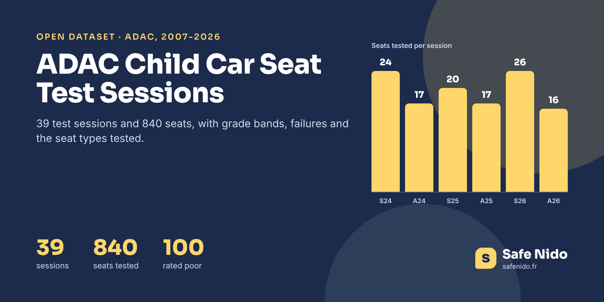

# ADAC Child Car Seat Test Sessions 2007-2026



[](https://doi.org/10.5281/zenodo.24167071) [](https://www.kaggle.com/datasets/safenido/adac-child-car-seat-test-sessions-2007-2026) [](https://huggingface.co/datasets/safenido/adac-child-seat-test-sessions) [](https://creativecommons.org/licenses/by/4.0/) [](https://www.safenido.fr/)

**English first, version française plus bas.**

Twice a year, in spring and autumn, ADAC and its European partners publish a new round of child car seat crash tests. This dataset has **one row per session, 39 sessions from 2007 to October 2026 and 840 seats**, with how many seats landed in each grade band, how many failed and why, which seat types were tested, the share with ISOFIX and the median price.

Each row links to the French page of that session on [Safe Nido](https://www.safenido.fr/test-adac/), where every seat of the session is listed with its result.

### The Headline Numbers

|  |  |
|---|---|
| Test sessions | 39 |
| Seats tested | 840 |
| Rated poor | 100 |
| Failed on safety | 56 |
| Failed on harmful substances | 52 |
| Biggest session | Spring 2017, 37 seats |
| Latest session | Autumn 2026, 16 seats |

A poor grade does not always mean a seat broke in the crash. Over the years, about half of the failures came from the safety part and half from harmful substances found in the fabrics, and a few seats failed on both. The two columns poor_because_of_safety and poor_because_of_substances keep them apart.

### Files

| file | content |
|---|---|
| `data/adac_child_seat_test_sessions_2007_2026.csv` | 39 rows, one per test session |
| `images/cover.png` | Cover image, 1600 × 800 |

### Columns

**adac_child_seat_test_sessions_2007_2026.csv**

| column | description |
|---|---|
| `session` | Session id, season-year |
| `year` | Year |
| `season` | spring or autumn |
| `month` | Month of publication |
| `protocol_era` | ADAC protocol era |
| `seats_tested` | Seats with a published grade |
| `very_good` | Seats rated very good (up to 1.5) |
| `good` | Seats rated good (1.6 to 2.5) |
| `satisfactory` | Seats rated satisfactory (2.6 to 3.5) |
| `sufficient` | Seats rated sufficient (3.6 to 4.5) |
| `poor` | Seats rated poor (above 4.5) |
| `poor_because_of_safety` | Seats graded poor on the safety part |
| `poor_because_of_substances` | Seats graded poor on harmful substances |
| `mean_overall_grade` | Average overall grade, 0.5 best to 5.5 worst |
| `infant_carriers` | Infant carriers tested |
| `rotating_or_reversible` | Rotating or reversible seats tested |
| `rear_facing_only` | Rear-facing only seats tested |
| `harness_or_shield` | Harness, shield and all-in-one seats tested |
| `boosters` | Boosters tested |
| `isofix_share_pct` | Share of seats with ISOFIX |
| `median_price_eur` | Median price at the time of the test |
| `sources` | ADAC alone or with ÖAMTC |
| `safenido_url` | Session page on Safe Nido |

### Load It

```python
import pandas as pd

base = "https://raw.githubusercontent.com/safenido/adac-child-seat-test-sessions/main"
df = pd.read_csv(f"{base}/data/adac_child_seat_test_sessions_2007_2026.csv")
df[["session", "seats_tested", "poor", "safenido_url"]].tail(10)
```

### How It Was Built

Built from the Safe Nido database of every published ADAC child seat result since 2007, grouped by year and season. Seat types follow Safe Nido's own classification. Only counts and averages are published here.

### Checked Against The Source

Session sizes match the ADAC announcements for the recent sessions (16 seats in October 2026, 26 in May 2026), and the total of 840 matches the companion crash test statistics.

### Read With Care

- **Protocols change** in 2011, 2015, 2020 and 2025, so compare averages within an era.
- **A seat can fail on both parts**, so the two failure columns can add up to more than poor.
- **Individual results are not published here.** They belong to ADAC and ÖAMTC.

### License And Citation

**[CC BY 4.0](https://creativecommons.org/licenses/by/4.0/)**. Use it, share it and adapt it, commercially or not, and credit **Safe Nido** with a link to **[safenido.fr](https://www.safenido.fr/)**, along with the original source below.

```bibtex
@misc{safenido_adac_child_seat_test_sessions_2026,
  title  = {ADAC Child Car Seat Test Sessions 2007-2026},
  author = {{Safe Nido}},
  year   = {2026},
  doi    = {10.5281/zenodo.24167071},
  url    = {https://github.com/safenido/adac-child-seat-test-sessions},
  note   = {Dataset, version 1.0}
}
```

Source. Published results of the ADAC and ÖAMTC child seat tests, aggregated by Safe Nido, https://www.safenido.fr/test-adac/

Archived on **[Zenodo](https://doi.org/10.5281/zenodo.24167071)** with a permanent DOI, 10.5281/zenodo.24167071.

Companion datasets, **[ADAC Child Car Seat Test Protocols 2007-2026](https://github.com/safenido/adac-child-seat-test-protocols)** ([Kaggle](https://www.kaggle.com/datasets/safenido/adac-child-car-seat-test-protocols-2007-2026), [Hugging Face](https://huggingface.co/datasets/safenido/adac-child-seat-test-protocols)), **[Child Car Seat Crash Test Statistics 2007-2026](https://github.com/safenido/child-car-seat-crash-test-statistics)** ([Kaggle](https://www.kaggle.com/datasets/safenido/child-car-seat-crash-test-statistics-2007-2026), [Hugging Face](https://huggingface.co/datasets/safenido/child-car-seat-crash-test-statistics)). All Safe Nido datasets are listed in **[Child Passenger Safety Datasets](https://github.com/safenido/child-passenger-safety-datasets)**.

Also on **[GitHub](https://github.com/safenido/adac-child-seat-test-sessions)**, **[Kaggle](https://www.kaggle.com/datasets/safenido/adac-child-car-seat-test-sessions-2007-2026)** with a starter notebook, and **[Hugging Face](https://huggingface.co/datasets/safenido/adac-child-seat-test-sessions)**, ready for the `datasets` library.

### On Safe Nido

The data behind these files is used on [Safe Nido](https://www.safenido.fr/), an independent French guide to child car seats built on twenty years of crash tests.

- [Every ADAC session, explained in French](https://www.safenido.fr/test-adac/)
- [Autumn 2026 session](https://www.safenido.fr/test-adac/automne-2026/)
- [How to read an ADAC grade](https://www.safenido.fr/crash-test-siege-auto/lire-une-note-adac/)

---

## Version Française

### Les Sessions De Tests ADAC, 2007-2026

Une ligne par session de tests ADAC depuis 2007, 39 sessions et 840 sièges, avec le nombre de sièges par niveau de note, les échecs et leur cause, les types de sièges testés et un lien vers la page de chaque session sur Safe Nido.

Licence CC BY 4.0, en citant **Safe Nido** et un lien vers **[safenido.fr](https://www.safenido.fr/)**. Retrouvez les guides et les fiches des sièges sur [Safe Nido](https://www.safenido.fr/).
